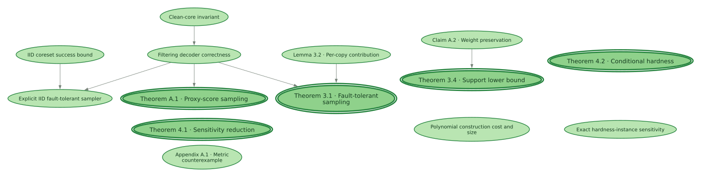

# Fault Tolerant Coresets

Lean formalization of the sampling and decoding guarantees, lower bound,
sensitivity reduction, and conditional hardness transfer in **Fault Tolerant
Coresets**, by Milind Prabhu, Chris Schwiegelshohn, and Sudarshan Shyam.

[Source paper](source/coreset_notes.pdf) · [Formalization notes](FORMALIZATION.md) · [Verification record](VERIFICATION.md)

## Explore the proof

Download and open the self-contained [interactive proof graph](blueprint/generated/Fault_Tolerant_Coresets_Blueprint.html).
Select a theorem or lemma to inspect its Lean statement, proof, and compiled dependencies.

[](blueprint/generated/Fault_Tolerant_Coresets_Blueprint.html)

Theorem 4.2 assumes the external gap-k-means hardness result. The formalized
bit-cost model and other hypotheses are detailed in the [formalization notes](FORMALIZATION.md).

## Build and verify

Install [elan](https://github.com/leanprover/elan), clone this repository, and run:

```bash
bash bootstrap.sh
bash check.sh
```

Lean **4.31.0** and mathlib are pinned. The check builds the library, verifies
all 67 public axiom audits, and runs both executable demonstrations.
[Build status](https://github.com/sudarshanshy/fault-tolerant-coresets-lean/actions/workflows/lean.yml).

See [blueprint instructions](blueprint/README.md) to regenerate the graph.
